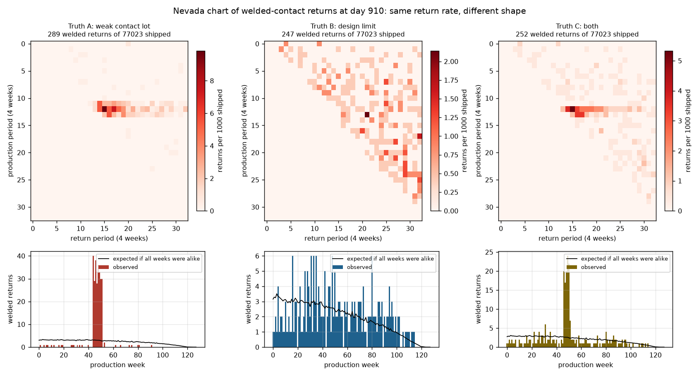

# Welded relay contacts in a switch actuator: bad batch or design limit?

**Simulated study, no hardware. There is no real return data in this repository.**
The field failures are produced by a physically based generator (LED inrush,
contact bounce, weld probability, installations, return reporting) for three
hidden truths. The analysis then works only on what a quality engineer would
have: shipments per production week and the returned units. The value is in the
failure physics and in the method that separates the hypotheses, not in the data.

## The question

A switch actuator starts coming back from the field with welded relay contacts.
Is it a bad production batch or a design limit met by LED lighting loads, how
would the return data show the difference, and which corrective action actually
removes it?

## The answer

1. **The closing angle changes the peak current more than it changes the
   energy that welds the contact.** The weld stress in this model is the energy
   of the arc while the contact bounces, as in the contact-welding literature.
   The inrush model reproduces the lamp-test table of IEC 60669-2-1 (15 W to
   400 W) within 7.3 % on peak current and 11.3 % on I2t without tuning. On the
   200 W test circuit, closing
   at the voltage zero instead of the peak cuts the peak current by 4.9 times
   (175 A to 35.8 A) but the bounce-arc energy only by 4.4 times (0.757 J to
   0.171 J), because the capacitor still has to be charged along the rising
   mains while the contact bounces. Closing at 45 degrees still gives 87 % of
   the worst-case arc energy. The best aiming point is 10 degrees (0.56 ms)
   before the zero: 8.9 times less arc energy.

2. **The same return rate looks different in the two truths, but only in some
   views.** At day 910 all three truths have 0.32 to 0.38 % welded returns
   (289, 247 and 252 of 77 000 shipped). What separates a weak contact lot (A)
   from a design limit (B): the production-week scan (likelihood ratio 570
   against 3.3, medians of 30 replicates) and the reported load of the returns
   compared with the 200 W rating (29 % of welded returns above the rating in A,
   100 % in B; median 121 W against 836 W). What does not decide: the return
   rate (tuned to be equal); a "load effect" as such (welded returns sit on
   bigger LED loads than other-cause returns in both truths: odds ratio 21 in
   A, 2580 in B, both with p below 1e-10); and the Weibull shape taken alone.
   The shape differs (0.44 in A, 0.65 in B) but is below 1 in both, so the
   textbook reading "below 1 means early-life production defect" blames
   production in B, where production is fine. In B the last production week
   also returns 3.1 times more than the first, only because later units went
   into a more LED-heavy mix; a scan without a trend term calls that a batch in
   23 % of replicates.

3. **How many returns before the verdict is safe (correct in at least 90 % of
   30 replicates): 56 for a weak lot, 18 for a design limit, 41 for the mixed
   case, if half of the returns come with a load questionnaire.** Without any
   load information the design limit needs about 250 returns (14 times more),
   and the mixed case is never recognised: in 29 of 30 replicates it is called
   a pure batch at 251 returns, although more than half of its returns are
   design-limit failures (56 % on the main seed). An early verdict can also be
   overtaken: at day 380 the mixed truth is called "design" in 29 of 30
   replicates, correctly for that day, because the weak lot has not started to
   fail yet.

4. **Zero-cross switching keeps its benefit only if the closing time is known
   to a fraction of a millisecond.** Ideal timing with the optimised aiming
   point reduces 10-year welds by 149 times; aiming exactly at the zero gives
   only 16 times. With a closing-time scatter of 0.25 ms the reduction is 75
   times, with 0.5 ms 18 times, with 1 ms 3.7 times and with 1.5 ms (a fixed
   delay without calibration) 2.0 times. Half of the benefit (on a log scale)
   is gone at 0.59 ms.

5. **Decision: point-on-wave closing with the closing time measured on every
   operation.** On an LED-heavy installed base the baseline welds 6.65 % of
   channels in 10 years. Only two options get below the 0.5 % requirement:
   measured point-on-wave closing (0.089 %, about +0.55 EUR per channel) and a
   hybrid relay (0.088 %, about +1.60 EUR). A series NTC helps by only 1.33
   times (it limits the peak, not the charge) and costs 5.1 W per channel at
   16 A. A relay with a tungsten pre-make contact is 13 times better over 2
   years but only 3.0 times over 10 years; that result hangs on the wear
   assumption (1.9 to 22 times across the sensitivity runs). A published 200 W
   limit with 70 % compliance gives 2.4 times. And the corrective action does
   little for the next year: 87 % of the next 52 weeks of returns come from
   units built before the cut-in.

Cost figures, the field population and several physics parameters are
assumptions. They are listed in `DOSSIER.md` section 7 with their sensitivity runs.



*Key figure: welded returns by production period and return period for the
three hidden truths at the same return rate. The weak lot is a horizontal band,
the design limit fills the whole triangle and grows toward late production.*

Other figures, all produced by `scripts/run_all.py`:

- `results/fig1_inrush_validation.png`: model against the standard's Ipeak and I2t table, the effect of the closing angle on peak current and on bounce-arc energy, and how the peak saturates with lamp count on the line impedance.
- `results/fig2_weld_probability.png`: weld probability per operation against LED load for three lamp classes, and how a weak lot or a stronger contact shifts the curve.
- `results/fig4_weibull.png`: Weibull plots of the three truths with median-rank regression and maximum likelihood.
- `results/fig5_returns_needed.png`: share of correct verdicts against the number of welded returns, with and without load information.
- `results/fig6_views_separation.png`: which views separate truth A from truth B over 30 replicates.
- `results/fig7_zero_cross.png`: weld reduction against closing-time scatter and the best aiming point.
- `results/fig8_trade_study.png`: 10-year weld fraction and cost per option.
- `results/fig9_forecast.png`: blind warranty-return forecast with and without the corrective action against the hidden truth.
- `results/ishikawa.png`: cause-and-effect diagram used in the 8D report.

## How to run

```
python -m venv .venv && .venv/Scripts/python -m pip install -r requirements.txt
.venv/Scripts/python -m pytest -q            # 53 tests
.venv/Scripts/python -m scripts.run_all      # 4 minutes on an idle laptop; writes results/*.png and results/summary.json
```

On Linux or macOS use `.venv/bin/python`. `--quick` runs fewer replicates and
writes `results/summary_quick.json` (used in CI).

## What is modelled and what is not

Modelled:

- Inrush of a capacitor-input lamp load: source and wiring R and L, lamp series
  resistance, bulk capacitor behind a rectifier, closing at any phase angle,
  number of lamps in parallel, three lamp classes and three supply classes.
- Contact bounce (two openings, random timing) with a short arc of constant
  voltage; the arc energy per operation is the weld stress.
- Weld probability per operation from arc energy, a wear term, unit-to-unit
  spread and a weak contact lot. The level is calibrated on the 40 000-operation
  lamp test at the 200 W rating.
- Field population: 600 units per production week, shipping and commissioning
  lag, residential and commercial LED channels, switching frequency, unrelated
  failures, 60 % of failures returned, return lag, load questionnaire on half of
  the returns, censored units.
- Blind analysis: Weibull with suspensions (two estimators, confidence bounds),
  Nevada chart, production-week trend and scan test, case-control load test,
  decision rule, forecast.
- Five corrective actions in eight variants with the same physics.

Not modelled:

- Welding by Joule heating of the closed contact at very high peak current
  (the static regime). Only the bounce arc welds in this model, so a series
  resistance looks weaker here than a relay maker's peak-current rating suggests.
- Break arcs, contact material transfer and contact resistance growth as such;
  wear is one lumped term.
- Residual charge in the lamp capacitor at re-closing, circuit-breaker tripping
  at very large LED loads, mains voltage variation and harmonics.
- The relay coil circuit. Closing-time scatter is an input, not a result.
- Customer behaviour beyond a fixed return probability.

## Limits and what I would do next with real hardware

- The weld threshold (45 J median arc energy for a nominal contact) is not a
  measured value. It follows from one calibration point and an assumed scatter.
  The absolute weld rates are therefore only as good as that calibration; the
  ratios between options are more robust (see the sensitivity table in the dossier).
- Bounce timing decides the zero-cross result. With a 200 us bounce instead of
  600 us the benefit of measured point-on-wave closing rises from 75 times to
  about 16 000 times. First task with hardware: record contact voltage and
  current of the real relay at make on the 200 W and 400 W lamp-test circuits,
  100 operations each at 0, 45 and 90 degrees, and replace the assumed bounce
  and arc-energy distributions.
- Second task: run the IEC 60669-2-1 lamp-load endurance test to failure at 200,
  400 and 800 W on a few relays to get a real weld-probability curve and the
  wear effect.
- Third task: log the closing time of 20 relays over temperature (-5 to 45 deg C)
  and coil voltage to replace the assumed 0.25 / 0.7 / 1.5 ms scatter levels.
- The blind analysis was tuned on nothing, but it was only tried on truths that
  I built. Real returns have duplicates, wrong serial numbers and no-fault-found
  units. The decision rule misclassified the mixed case in 3 of 16 replicates
  in the two sensitivity runs where returns were few (54 and 72 on average).
- The 12-month forecast was 3 % low on the main population (341 forecast, 351
  in the hidden truth). That was luck: over ten more populations of the same
  truth the error ran from -22 % to +32 %, 13 % on average in absolute terms.

## Repo map

```
relayret/inrush.py      circuit model of the make transient with bounce and arc
relayret/weld.py        arc-energy grid, weld probability per operation, calibration
relayret/field.py       hidden truths, population and return generator, observation
relayret/weibull.py     median-rank regression and maximum likelihood with suspensions
relayret/analysis.py    blind analysis: Nevada, scan test, load test, decision, forecast
relayret/corrective.py  corrective-action options and their evaluation
scripts/run_all.py      regenerates every figure and results/summary.json
scripts/figures.py      plotting
tests/                  53 tests (Weibull against lifelines and scipy, inrush against the standard's table)
results/                figures and summary.json (all README numbers come from it)
docs/8D_REPORT.md       8D report for truth B, with containment and effectiveness check
docs/FMEA.md            FMEA extract before and after
docs/SOURCES.md         every source with URL and what was taken from it
DOSSIER.md              systems-engineering dossier: requirements, model, validation, trade study, V&V
```

MIT licence.
