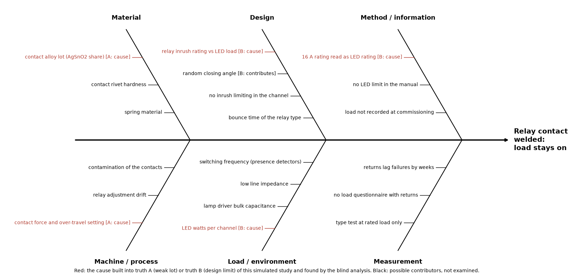

# 8D report: relay contacts welded in the field (switch actuator, 16 A channel)

**This is a simulated case.** The returns are those of hidden truth B of this
repository at day 910, seed 2026. The report was written from the blind
analysis only and then checked against the truth (last section). Lab steps
that need hardware are marked "to do"; nothing in this report was measured.
Numbers come from `results/summary.json`.

| | |
|---|---|
| Symptom | Channel output stays on after an "off" command. Lab finding on returns: relay contact welded. |
| Product | Multi-channel switch actuator, one 16 A AgSnO2 relay per channel, random closing angle |
| Period | Production weeks 0 to 129, returns received up to day 910 |
| Size | 247 welded returns of 77 000 channels shipped (0.32 %), plus 186 returns with other causes |

## D1 Team

Quality (lead), hardware development, firmware development, supplier quality
(relay), production, technical support. In this repository one person plays
all roles.

## D2 Problem description

| | Is | Is not |
|---|---|---|
| What | Normally-open contact welded closed; coil and driver work | Coil failure, driver failure, firmware hang (these are in the 186 other returns) |
| Where in production | All production weeks; the rate rises steadily, last week 3.1 times the first | Not concentrated in a few weeks: scan for a window p = 0.39 |
| Where in the field | Channels with LED lighting; all 125 welded returns with a questionnaire report more than 200 W of LED lamps, median 791 W | Channels with small LED loads or other load types |
| When | At any age; Weibull shape 0.65 (90 % bounds 0.59 to 0.72), about 0.66 % returned within 3 years | Not a wear-out wall, not only in the first weeks |
| How many | 247, rising; 11 to 22 per four weeks in the last half year | |

The Weibull shape below 1 would normally point to early-life defects. Here it
does not: units on very different loads have very different constant hazards,
and such a mix always gives a falling population hazard.

## D3 Containment

The data do not point at any production lot, so stopping shipments or sorting
stock would not remove anything. Containment aims at the installed load:

1. Technical note to installers and support, effective immediately: at most
   200 W of LED lamps per channel; larger LED groups are split over channels or
   switched through a contactor rated for the inrush. Model estimate of the
   effect at 70 % compliance: 2.4 times fewer welds over 10 years on new
   installations. It does nothing where the note is not read.
2. Replacement units for welded returns go out with that note and with a load
   questionnaire, so that the same channel does not weld again.
3. For projects known to have large LED groups: offer the variant with a
   tungsten pre-make relay where it exists (model estimate 13 times fewer welds
   in the first 2 years).
4. Safety check, to do: list load types other than lighting on these channels
   for which "cannot be switched off" is hazardous, and inform those customers
   first.
5. From now on every return is logged with production week, commissioning
   date, LED watts and lamp count. Without the load information this decision
   would have needed about 250 returns instead of 18 (replicate study).

## D4 Root cause

**Occurrence.** The channel is rated for 200 W of self-ballasted lamps, the
value the switch standard assigns to a 16 A switch. On a share of installations
the LED load is two to eight times that. Each switch-on charges the lamps' bulk
capacitors through a contact that bounces for about a millisecond. The charge
that flows while the contact is open goes through an arc. Its energy (0.5 J per
operation at 200 W, about 2 J at 800 W) melts the contact
surface, and on a fraction of operations the weld is stronger than the opening
force of the relay. In the model that fraction is 1.0e-7 per operation at
200 W, 6.7e-6 at 400 W and 1.4e-4 at 800 W of high-inrush lamps: 0.02 %, 1.5 %
and 26 % of channels per year at six operations a day. The closing angle is
random, and nothing in the product limits or measures the inrush.

**Why it grew.** The share of channels with large LED groups rose with the
installation date. That, not production, explains the rise by production week.

**Why it was not caught.** The type test runs at the rated lamp load only. The
label and the manual say "16 A" and give no LED limit, so an installer reads
16 A as 3.6 kW of LED lamps. The design FMEA rated the occurrence for the rated
load. Returns came back without load information.

Evidence:

| Check | Result | Says |
|---|---|---|
| Scan over production weeks, trend fitted first | no window, p = 0.39 | not a lot |
| Trend by production week | 3.1 times from first to last week, p = 2e-5 | something changes with time |
| Load of welded returns against other-cause returns | 125 of 125 above 200 W against 8 of 95; odds ratio 2580; p = 2e-52 | the change is the installed load |
| Welded returns within the rating | 0 of 125 | the product does what it is rated for |
| Same scan without the trend term | no window here (weeks 92 to 102, p = 0.27), but a false "batch" in 7 of 30 replicate populations of this truth | the trend term is needed |

Still to do on hardware before D4 is closed: section and analyse the contacts
of ten returns (weld nugget, alloy, contact force of the surviving channels of
the same unit); reproduce the weld on new relays on an 800 W lamp-load
circuit (the standard's lamp model scaled up). The model predicts a weld within about 7 000 operations at random
closing angle there; if new relays survive 40 000, the root cause above is wrong.

## D5 Corrective action chosen and verified

Options were compared with the same model (`DOSSIER.md` section 6):

| Option | Welded in 10 years, LED-heavy mix | Verdict |
|---|---|---|
| Baseline | 6.65 % | - |
| Series NTC 1 ohm | 5.01 % | rejected: limits the peak, not the charge; 5.1 W per channel at 16 A |
| Zero-cross with fixed delay (1.5 ms scatter) | 3.37 % | rejected |
| Published 200 W limit, 70 % compliance | 2.82 % | containment only; depends on the installer |
| Relay with tungsten pre-make contact | 2.24 % | interim for known large LED projects |
| Zero-cross, end-of-line calibrated (0.7 ms) | 0.858 % | misses the 0.5 % target |
| **Point-on-wave closing, closing time measured (0.25 ms)** | **0.089 %** | **chosen** |
| Hybrid relay | 0.088 % | meets the target at about three times the added cost |

Chosen action: the firmware closes each relay about 0.6 ms before the voltage
zero of its own channel, measures the real closing instant on every operation
and corrects the delay with a moving average. Hardware addition: voltage sense
on the load side of each channel.

Verification plan (to do), with acceptance limits taken from the model:

1. Closing-angle histogram on 20 units, -5 to 45 deg C, coil supply at its
   limits, 40 000 operations: standard deviation at most 0.3 ms, mean within
   0.2 ms of the aiming point.
2. Lamp-load endurance test of IEC 60669-2-1, 19.109, 40 000 operations at
   400 W with the product's own timing: no sticking on any of the specimens
   (model: 0.9995 per specimen; baseline 0.00).
3. The same at 800 W for 10 000 operations as a margin test.
4. Fault insertion: sense input open and stuck; the channel must fall back to
   random closing and raise its diagnostic flag within 10 operations.

## D6 Implementation and effectiveness check in the field

Cut-in at production week 140. Serial-number break documented.

The total number of returns is the wrong measure of success. Blind forecast
for the 52 weeks after the cut-off: 341 welded returns without the action, 296
with it. 87 % of next year's returns come from units built before the cut-in.
(Checked against the hidden truth afterwards: 351 and 311, so the forecast was
3 % and 5 % too low. Over ten more populations of the same truth the error ran
from -22 % to +32 %, so plan with about +/-30 %.)

Effectiveness is therefore confirmed by production cohort at equal age:

- Nevada chart, rows from week 140 on: welded returns per 1000 shipped at the
  same age must be at most one tenth of the rows before the cut-in.
- Load check: welded returns from the new cohort are examined with the
  questionnaire; any weld above 200 W of LED load on a new unit triggers a
  review of the closing-time log of that unit.
- The production-week scan is repeated every four weeks. The verdict is only
  valid for the day it is made: in the mixed truth of this study a correct
  "design" verdict at day 380 had to be changed to "mixed" by day 440, when a
  weak lot built in weeks 46 to 51 reached the returns lab.

For the installed base nothing changes with the cut-in. The note of D3 stays
in force, and support receives the list of high-load channels as returns
identify them.

## D7 Prevention

- Design rule: every relay output has a stated LED lamp rating in watts,
  printed next to the ampere rating, in the manual and in the commissioning tool.
- Requirement added: lamp-load endurance at twice the declared LED rating as a
  margin test in design verification, not only at the rating.
- FMEA updated (`FMEA.md`): highest RPN from 448 to 240; three new failure
  modes of the corrective action entered with their detection.
- Supplier quality: a sample of every relay lot runs a shortened lamp-load
  endurance test. This is aimed at the other possible cause (a weak contact
  lot), which this analysis could exclude here but which produces the same
  symptom and the same return rate.
- Returns process: production week, commissioning date and load questionnaire
  are mandatory fields; other-cause returns are kept as the reference group
  for load comparisons.
- Method: production-week tests always include a trend term; a Weibull shape
  below 1 is not read as a production defect without the production-week and
  load views.

## D8 Closure

Closed when: the hardware checks of D4 confirm the mechanism, the D5
verification passes, and two quarters of the new cohort show the rate
reduction of D6. Lessons learned are filed with the design rules above.

---

## How the same report would differ for the other two truths

| | Truth A: weak contact lot | Truth C: both |
|---|---|---|
| D2 "where" | weeks 44 to 51 only, rate ratio 124, 91 % of welded returns | weeks 46 to 51 with rate ratio 12, 40 % of welded returns; the rest spread over all weeks |
| D2 load | 65 % of welded returns at or below the 200 W rating, median 120 W | 93 % above the rating |
| D3 | block and sort stock of those weeks; replace installed units by serial number | both: lot action and installer note |
| D4 | relay lot: contact alloy or contact force (supplier 8D) | two root causes, two branches |
| D5 | lot acceptance test at the supplier and at incoming inspection | lot acceptance test and point-on-wave closing |
| Risk of a wrong report | calling it a design limit because welded units "had more LED lamps than usual" (odds ratio 21, p = 2e-11) | closing the report after the lot action: without load information 29 of 30 replicates call it a pure batch |

## Check against the hidden truth (done after the report was written)

| Item | Blind result | Truth |
|---|---|---|
| Verdict | design limit | truth B: design limit, no weak lot |
| Production window | none | none |
| Share of welded returns above the rating | 100 % (125 of 125 with questionnaire) | 100 % of all 247 |
| Welded failures in the field | not observable; 247 returned | 450 failed, 247 returned |
| Forecast next 52 weeks, no action | 341 | 351 |
| Forecast with action | 296 | 311 |
